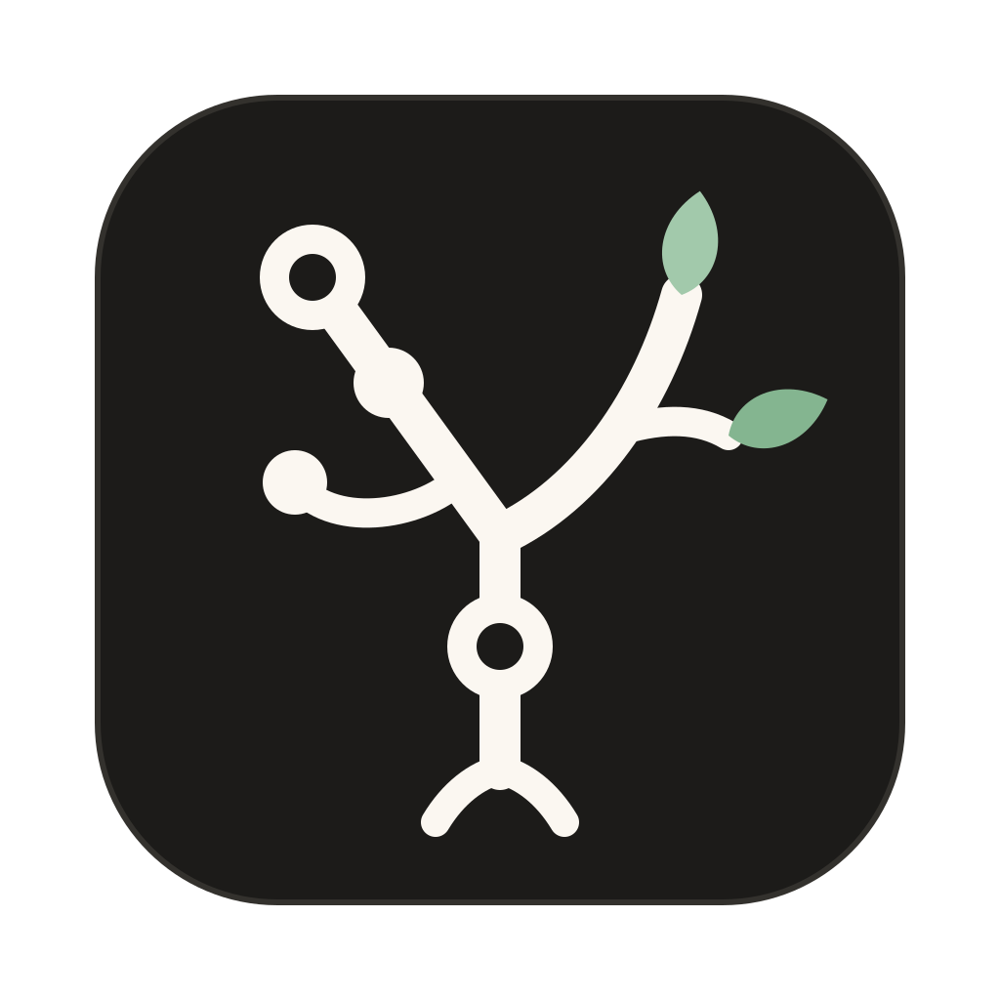
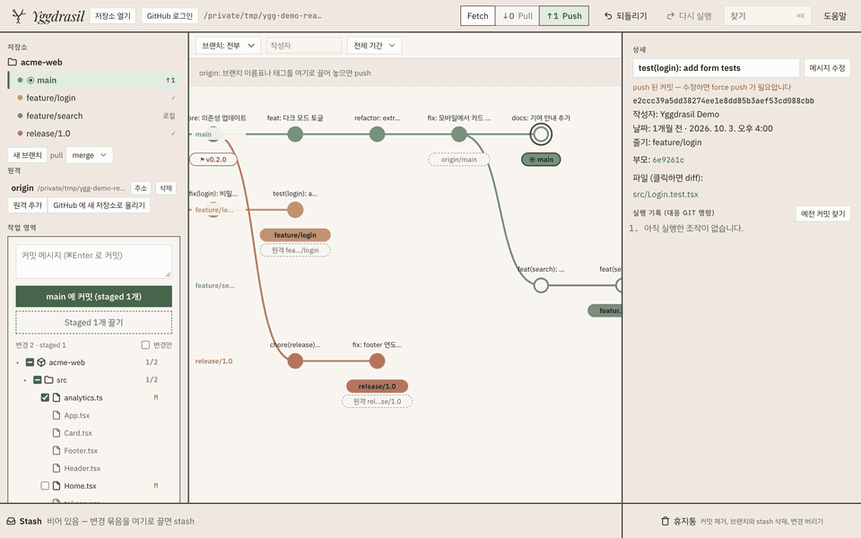
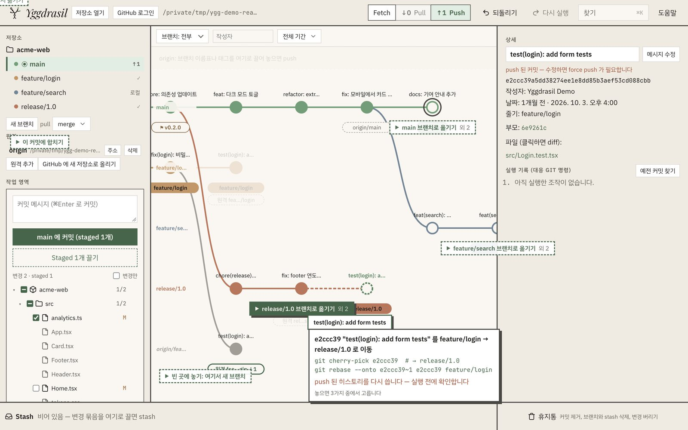
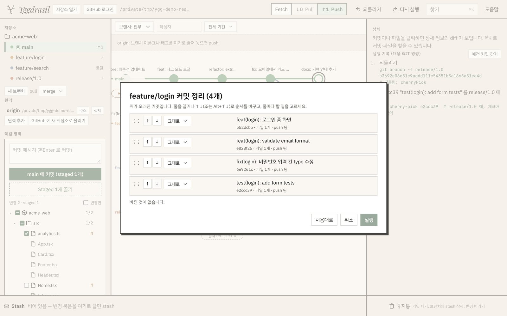
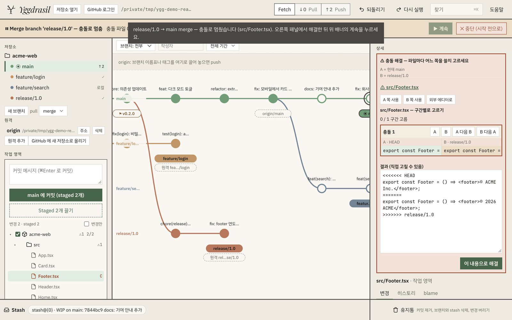
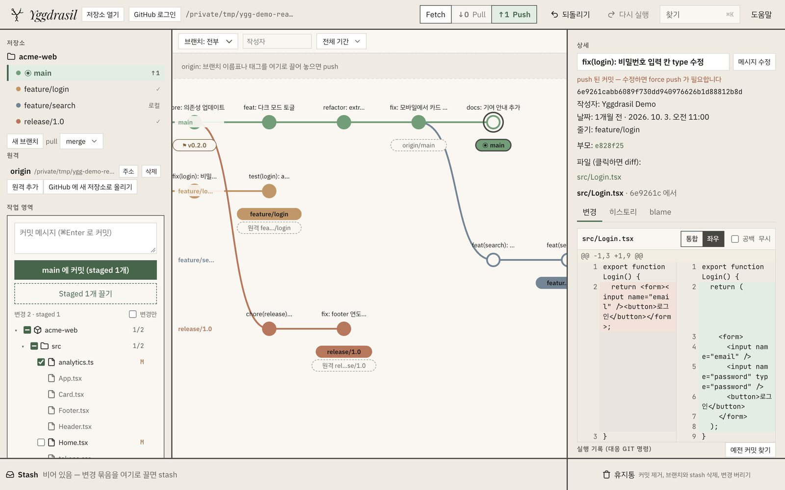
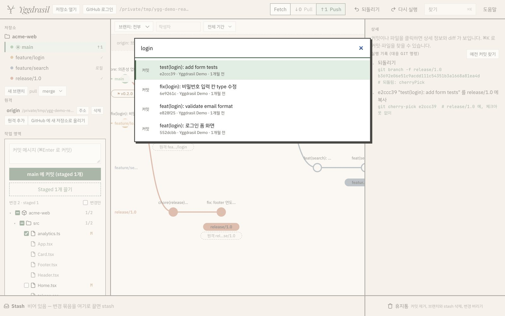
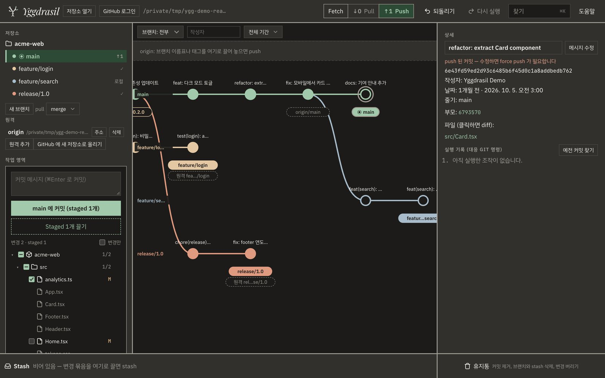
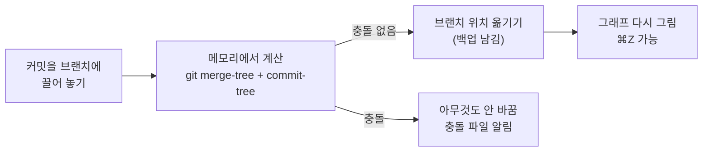

<div align="center">



# Yggdrasil

**커밋 그래프를 끌어 놓아 git 히스토리를 고치는 앱.**<br/>
명령어를 외우지 않아도 되고, 무엇을 하든 <kbd>⌘Z</kbd> 로 되돌릴 수 있어요.

[English](README.md) · **한국어**

[](https://github.com/202021042khj/git-yggdrasil/actions/workflows/ci.yml)
[](https://github.com/202021042khj/git-yggdrasil/releases/latest)
[](https://github.com/202021042khj/git-yggdrasil/releases)


[](LICENSE)
[](https://github.com/202021042khj/git-yggdrasil/stargazers)

<br/>

[**⬇ 다운로드**](#-다운로드) &nbsp;·&nbsp; [기능](#-기능) &nbsp;·&nbsp; [동작 방식](#-동작-방식) &nbsp;·&nbsp; [직접 빌드하기](#-직접-빌드하기)

<br/>



</div>

<br/>

## ✨ 왜 Yggdrasil 인가요

> git 은 나무예요. 그렇다면 *손으로 만질 수* 있어야 하죠.

- **🌳 치지 말고 끌어 놓으세요.** 커밋을 브랜치에 놓으면 옮기거나 복사하고, 브랜치를 다른 브랜치에 놓으면 merge 나 rebase 를 해요. 손을 떼기 *전에* 결과가 미리 그려져요.
- **🛟 처음부터 안전하게.** 히스토리 조작은 `git merge-tree` 로 작업 폴더를 건드리지 않고 계산해요. 충돌이 날 것 같으면 **아무것도 바꾸지 않고** 어떤 파일인지 알려 줘요.
- **↩️ 전부 되돌릴 수 있어요.** 모든 조작이 실제로 실행한 git 명령과 함께 기록되고, <kbd>⌘Z</kbd> · <kbd>⇧⌘Z</kbd> 로 앞뒤로 오갈 수 있어요.
- **🎓 쓰면서 git 을 배워요.** 놓을 자리와 메뉴마다 진짜 명령(`git cherry-pick …`, `git rebase --onto …`)이 보여요. 언제든 터미널에 그대로 쓸 수 있어요.

<br/>

## ⬇ 다운로드

| | 파일 | 참고 |
|---|---|---|
|  **macOS · Apple Silicon** | [Yggdrasil-mac-arm64.dmg](https://github.com/202021042khj/git-yggdrasil/releases/latest/download/Yggdrasil-mac-arm64.dmg) | macOS 12 이상 |
|  **macOS · Intel** | [Yggdrasil-mac-x64.dmg](https://github.com/202021042khj/git-yggdrasil/releases/latest/download/Yggdrasil-mac-x64.dmg) | macOS 12 이상 |
| 🪟 **Windows** | [Yggdrasil-windows-setup.exe](https://github.com/202021042khj/git-yggdrasil/releases/latest/download/Yggdrasil-windows-setup.exe) | Windows 10 이상 (x64) |
| 🐧 **Linux** | [Yggdrasil-linux-x64.AppImage](https://github.com/202021042khj/git-yggdrasil/releases/latest/download/Yggdrasil-linux-x64.AppImage) | `chmod +x` 후 실행 |

[git](https://git-scm.com/downloads) 2.38 이상이 설치되어 있어야 해요.

<details>
<summary><b>처음 열 때 "열 수 없습니다" · "Windows의 PC 보호" 가 뜨면</b></summary>

<br/>

아직 코드 서명을 하지 않아서, 처음 한 번은 운영체제가 확인을 물어요.

**macOS (15 Sequoia 이상)**
1. 앱을 열어요. "Yggdrasil"이(가) 열리지 않았습니다 창이 뜨면 **완료** 를 눌러요 (휴지통으로 옮기지 마세요).
2. **시스템 설정 › 개인정보 보호 및 보안** 을 열고, 아래 *보안* 항목에서 Yggdrasil 옆 **그래도 열기** 를 눌러요.
3. 암호나 Touch ID 로 확인해요. 그다음부터는 그냥 열려요.

"손상되었기 때문에 열 수 없습니다" 가 뜨면 한 번만 실행하세요.

```bash
xattr -dr com.apple.quarantine /Applications/Yggdrasil.app
```

**Windows**
1. SmartScreen 이 "Windows의 PC 보호" 를 띄우면 **추가 정보** 를 눌러요.
2. 앱 이름이 Yggdrasil 인지 확인하고 **실행** 을 눌러요.

[Releases](https://github.com/202021042khj/git-yggdrasil/releases) 페이지의 파일마다 SHA-256 값이 있어서, 받은 파일이 맞는지 확인할 수 있어요.

</details>

<br/>

## 🧭 기능

<table>
<tr>
<td width="50%" valign="top">

### 끌어 놓아 히스토리 고치기
커밋을 브랜치 이름표에 끌어 놓고, 뜨는 메뉴에서 **옮기기**, **복사 (cherry-pick)**, **합치기** 중에 골라요. 결과 그래프가 미리 그려지고, 실행할 git 명령도 함께 보여요.

</td>
<td width="50%"></td>
</tr>
<tr>
<td></td>
<td valign="top">

### 커밋 정리 (interactive rebase)
한 창에서 순서 바꾸기, 메시지 수정, 합치기(squash · fixup), 빼기를 정하고 결과를 미리 본 뒤 실행해요. 체크아웃하지 않은 브랜치에도 돼요.

</td>
</tr>
<tr>
<td valign="top">

### 앱 안 충돌 편집기
merge · rebase · cherry-pick 이 충돌로 멈추면 배너가 떠요. 구간마다 **A**, **B**, **둘 다** 를 골라 결과를 바로 확인하고, 계속하거나 중단해요.

</td>
<td></td>
</tr>
<tr>
<td></td>
<td valign="top">

### diff · 히스토리 · blame
한 줄 보기와 좌우 비교, 공백 무시, 이미지 전후 비교, 이름이 바뀌어도 따라가는 파일 히스토리, 줄마다 보는 blame.

</td>
</tr>
<tr>
<td valign="top">

### <kbd>⌘K</kbd> 로 무엇이든 찾기
메시지 · 작성자 · 해시로 커밋을, 이름으로 파일을 찾아 바로 이동해요.

</td>
<td></td>
</tr>
<tr>
<td></td>
<td valign="top">

### 밝게 · 어둡게, 한국어 · English
시스템 화면 색과 언어를 따르고, 설정(<kbd>⌘,</kbd>)에서 바꿀 수도 있어요. 키보드만으로 쓸 수 있고 화면 낭독기도 지원해요.

</td>
</tr>
</table>

<details>
<summary><b>그 밖에 할 수 있는 일 전부</b></summary>

<br/>

| 분야 | 할 수 있는 일 |
|---|---|
| **매일 하는 일** | 파일 · 변경 덩어리 · 한 줄 단위 stage / unstage · 커밋, amend, 고른 경로만 커밋 · 변경 버리기 · 끌어서 stash · checkout, 새 브랜치, 브랜치 삭제 |
| **히스토리** | cherry-pick (여러 개도) · 커밋 옮기기 · 브랜치 rebase · merge · 합치기, 순서 바꾸기, 빼기 · revert · reset (soft / mixed / hard) · 브랜치 위치 옮기기 · 커밋 나누기 |
| **원격** | clone · fetch / pull / push (이름표를 원격 줄로 끌기) · 원격 추가 · 주소 변경 · 삭제 · upstream 연결 · 원격 브랜치 삭제 · 태그 (달기, 옮기기, 삭제, push) |
| **GitHub** | Device Flow 로그인 · 내 저장소 clone · 새 저장소로 올리기 · 브랜치에서 PR 만들기 · 리뷰와 검사 결과가 보이는 PR 목록 · `pr/<번호>` 로 받아 보기 |
| **복구** | reflog 와 앱 백업(`refs/yggdrasil/backup/`)에서 잃어버린 커밋 찾기 · 새 브랜치로 살리기, 복사하기, 그 커밋으로 되돌리기 |
| **저장소** | git 이 없는 폴더도 열기 (**git 시작하기** 가 `git init`) · 서브모듈 · worktree · Git LFS 표시 · 큰 저장소는 커밋 400개씩 불러오기 |
| **다른 호스트** | GitLab · Bitbucket · 사내 서버 HTTPS 로그인 (시스템 git 자격 증명 도우미 사용) · SSH · 호스트 키 · 권한 오류를 원인과 해결 방법으로 안내 |

</details>

<br/>

## 🔍 동작 방식



- 히스토리 조작을 **메모리에서 계산**해서, 체크아웃하지 않은 브랜치에도 되고 충돌이 나도 저장소가 반쯤 바뀐 채로 남지 않아요.
- 현재 브랜치가 바뀌면 `git reset --keep` 으로 작업 폴더를 맞춰요 (로컬 변경은 그대로, 덮어써질 것 같으면 git 이 거절해요).
- 조작하기 전의 브랜치 위치는 `refs/yggdrasil/backup/` 에 남아요.
- 터미널에서 시작해 멈춘 작업(멈춘 rebase, 충돌 난 merge)도 열면 그대로 이어서 해결할 수 있어요.

<details>
<summary><b>개인정보와 보안</b></summary>

<br/>

- Yggdrasil 은 설치된 `git` 을 실행할 뿐, 코드를 어디에도 보내지 않아요.
- GitHub 토큰은 OS 키체인(Electron `safeStorage`)으로 암호화해 두고, git 에는 **github.com 에 한해서 환경 변수로만** 넘겨요. 명령 인자로는 절대 넘기지 않아요.
- 다른 호스트의 비밀번호는 시스템 git 자격 증명 도우미에 바로 저장되고, 앱은 따로 보관하지 않아요.
- 화면은 샌드박스와 context isolation 으로 격리되어 있고, 다른 페이지로 이동하거나 새 창을 여는 것도 막혀 있어요.

</details>

<br/>

## ⌨️ 단축키

| 키 | 동작 | | 키 | 동작 |
|---|---|---|---|---|
| <kbd>⌘O</kbd> | 폴더 열기 | | <kbd>⌘K</kbd> | 커밋 · 파일 찾기 |
| <kbd>⌘⇧O</kbd> | URL 로 clone | | <kbd>⌘,</kbd> | 설정 |
| <kbd>⌘Z</kbd> | 마지막 조작 되돌리기 | | <kbd>⇧⌘Z</kbd> | 다시 실행 |
| <kbd>⌘↵</kbd> | 커밋 | | <kbd>Esc</kbd> | 끌기 취소 · 메뉴 닫기 |
| <kbd>←</kbd> <kbd>→</kbd> <kbd>↑</kbd> <kbd>↓</kbd> | 그래프에서 이동 | | <kbd>⇧F10</kbd> | 고른 항목의 메뉴 |

Windows 와 Linux 에서는 <kbd>⌘</kbd> 대신 <kbd>Ctrl</kbd> 을 써요.

<br/>

## 🛠 직접 빌드하기

```bash
git clone https://github.com/202021042khj/git-yggdrasil.git
cd git-yggdrasil
npm install
npm run dev
```

| 명령 | 하는 일 |
|---|---|
| `npm run dev` | 화면 자동 새로고침으로 실행 |
| `npm test` | 단위 · 통합 테스트 (Vitest) |
| `npm run e2e` | 실제 앱으로 E2E 테스트 (Playwright) |
| `npm run typecheck` · `npm run lint` | TypeScript · Biome |
| `npm run dist` | `dist/` 에 설치 파일 만들기 |

**기술:** Electron · React 19 · TypeScript · electron-vite · Vitest · Playwright · Biome

코드 구조는 [docs/ARCHITECTURE.md](docs/ARCHITECTURE.md), 배포 방법은 [docs/RELEASE.md](docs/RELEASE.md), 예전 개발 노트는 [docs/DEVELOPMENT.md](docs/DEVELOPMENT.md) 에 있어요. 출시는 release-please 가 커밋 메시지로 버전과 [CHANGELOG](CHANGELOG.md) 를 정하고, GitHub Actions 가 macOS · Windows · Linux 를 빌드 · 스모크 테스트해 초안 릴리스에 올려요.

<br/>

## 🤝 기여하기

버그 제보, 아이디어, PR 모두 환영해요.

1. [이슈](https://github.com/202021042khj/git-yggdrasil/issues)에 버그나 아이디어를 적어 주세요.
2. fork 해서 브랜치를 만들고, `npm run typecheck && npm run lint && npm test` 가 통과하는지 확인해 주세요.
3. PR 을 올려 주세요. CI 가 같은 검사와 E2E 를 돌려요.

화면 문구는 모두 `src/shared/i18n/` 에 있어요 (`ko.ts` 와 `en.ts` 는 키가 같아야 해요). 새 언어 번역도 정말 환영해요.

<br/>

## 📄 라이선스

[MIT](LICENSE) © 202021042khj. 자유롭게 쓰고, 고치고, 배포해도 돼요. 저작권 표시만 남겨 주세요.

<br/>

<div align="center">

**Yggdrasil 덕분에 git 이 조금 더 편해졌다면, ⭐ 하나가 다른 사람이 찾는 데 큰 도움이 돼요.**

<sub>북유럽 신화에서 모든 세계를 가지로 잇는 세계수의 이름을 땄어요.</sub>

</div>
