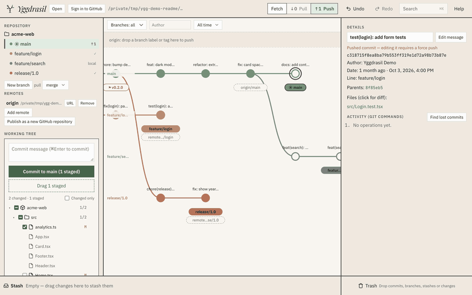
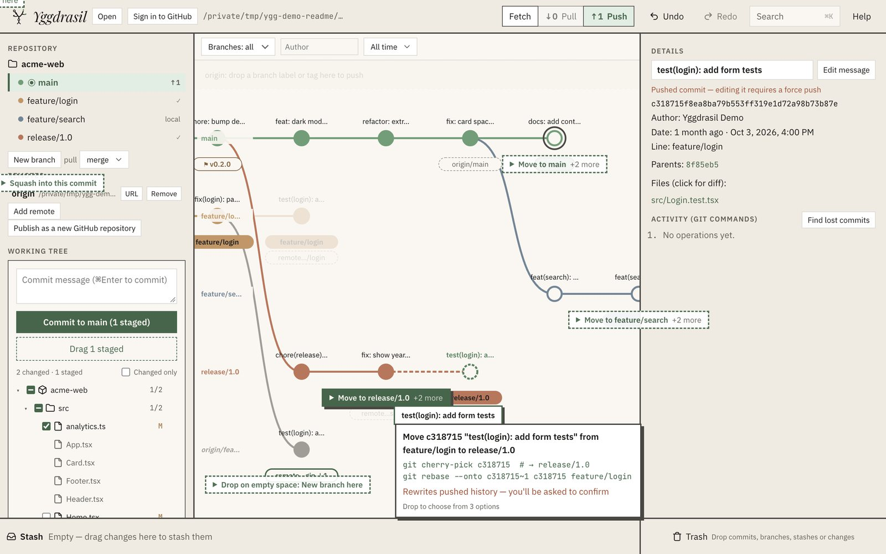
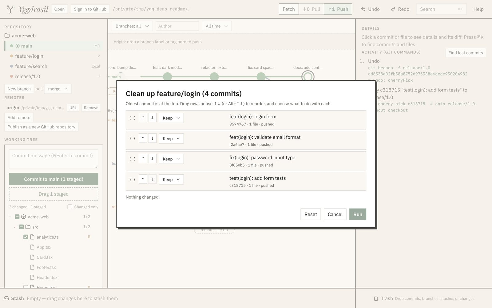
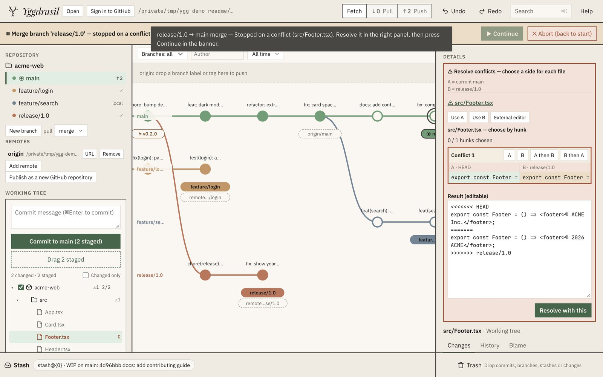
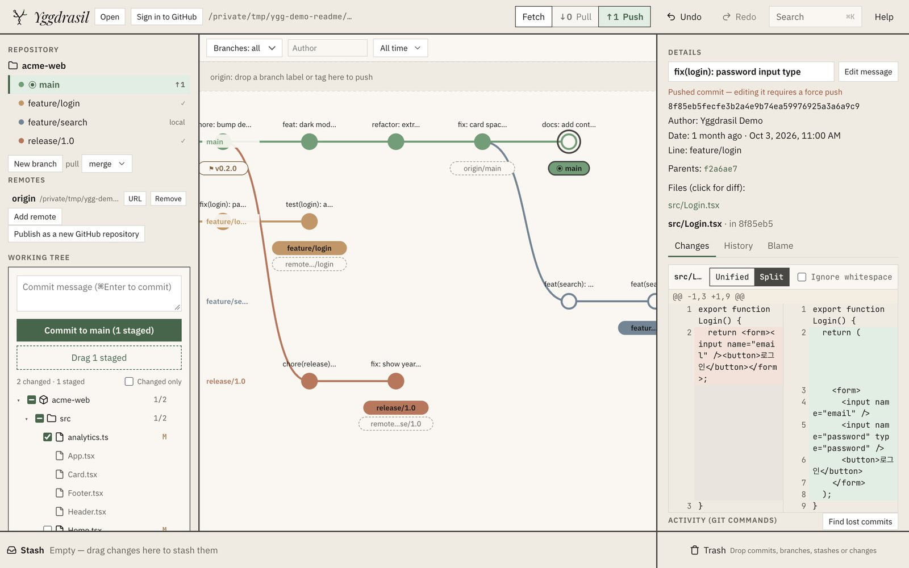
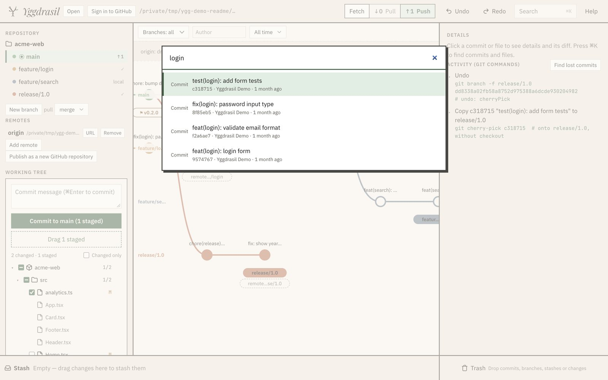
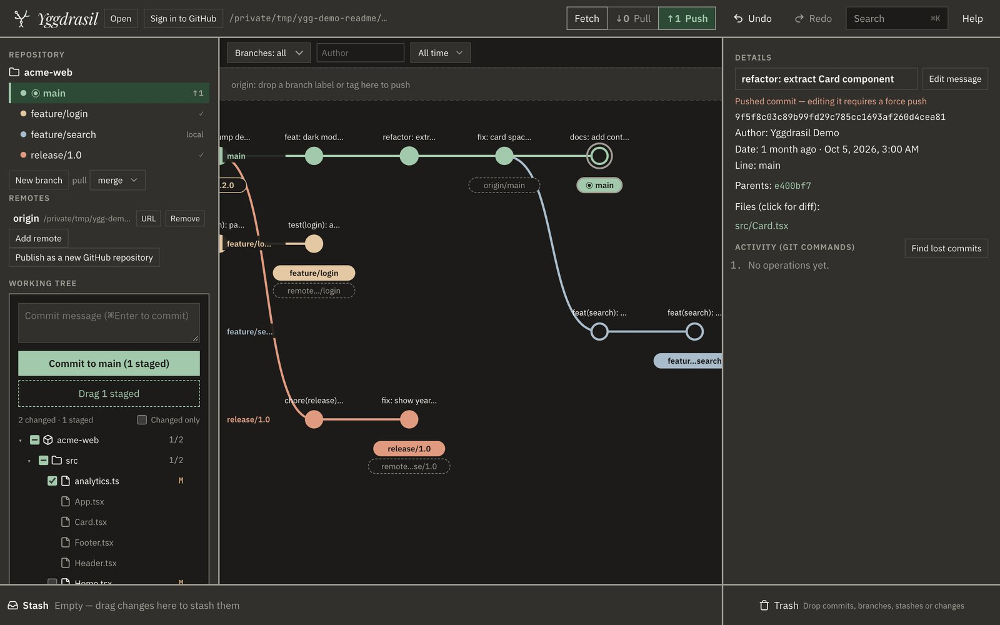
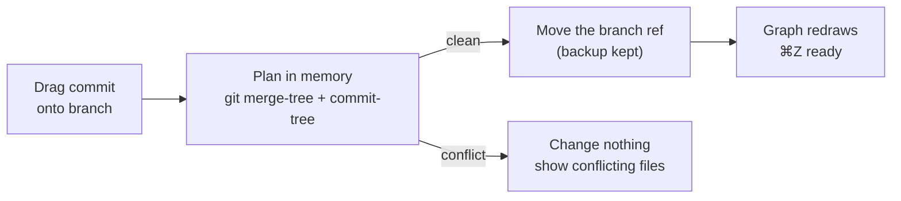

<div align="center">


# Yggdrasil

**Rewrite git history by dragging the commit graph.**<br/>
No commands to memorize, and every step can be undone with <kbd>⌘Z</kbd>.

**English** · [한국어](README.ko.md)

[](https://github.com/202021042khj/git-yggdrasil/actions/workflows/ci.yml)
[](https://github.com/202021042khj/git-yggdrasil/releases/latest)
[](https://github.com/202021042khj/git-yggdrasil/releases)


[](LICENSE)
[](https://github.com/202021042khj/git-yggdrasil/stargazers)

<br/>

[**⬇ Download**](#-download) &nbsp;·&nbsp; [Features](#-features) &nbsp;·&nbsp; [How it works](#-how-it-works) &nbsp;·&nbsp; [Build from source](#-build-from-source)

<br/>



</div>

<br/>

## ✨ Why Yggdrasil

> Git is a tree. You should be able to *touch* it.

- **🌳 Drag, don't type.** Drop a commit onto a branch to move or copy it. Drop a branch onto another to merge or rebase. A ghost preview shows the result *before* you let go.
- **🛟 Safe by design.** History edits are computed with `git merge-tree` without touching your working tree. If something would conflict, **nothing changes** and you're told which files.
- **↩️ Undo everything.** Every operation is logged with the exact git command it ran, and <kbd>⌘Z</kbd> / <kbd>⇧⌘Z</kbd> walk back and forth through them.
- **🎓 Learn git as you go.** Each drop target and menu item shows the real command (`git cherry-pick …`, `git rebase --onto …`). Copy them into your terminal anytime.

<br/>

## ⬇ Download

| | File | Notes |
|---|---|---|
|  **macOS · Apple Silicon** | [Yggdrasil-mac-arm64.dmg](https://github.com/202021042khj/git-yggdrasil/releases/latest/download/Yggdrasil-mac-arm64.dmg) | macOS 12+ |
|  **macOS · Intel** | [Yggdrasil-mac-x64.dmg](https://github.com/202021042khj/git-yggdrasil/releases/latest/download/Yggdrasil-mac-x64.dmg) | macOS 12+ |
| 🪟 **Windows** | [Yggdrasil-windows-setup.exe](https://github.com/202021042khj/git-yggdrasil/releases/latest/download/Yggdrasil-windows-setup.exe) | Windows 10+ (x64) |
| 🐧 **Linux** | [Yggdrasil-linux-x64.AppImage](https://github.com/202021042khj/git-yggdrasil/releases/latest/download/Yggdrasil-linux-x64.AppImage) | `chmod +x` then run |

Requires [git](https://git-scm.com/downloads) 2.38 or later on your `PATH`.

<details>
<summary><b>First launch: “can't be opened” / “Windows protected your PC”</b></summary>

<br/>

Yggdrasil isn't code-signed yet, so your OS asks for confirmation once.

**macOS (15 Sequoia or later)**
1. Open the app. When “Yggdrasil” Not Opened appears, click **Done** (don't move it to the Trash).
2. Open **System Settings › Privacy & Security**, scroll to *Security*, and click **Open Anyway** next to Yggdrasil.
3. Confirm with your password or Touch ID. From now on it opens normally.

If macOS says the app “is damaged”, run this once:

```bash
xattr -dr com.apple.quarantine /Applications/Yggdrasil.app
```

**Windows**
1. SmartScreen shows “Windows protected your PC”. Click **More info**.
2. Check the app name is Yggdrasil, then click **Run anyway**.

Every release lists a SHA-256 checksum next to each file on the [Releases](https://github.com/202021042khj/git-yggdrasil/releases) page, so you can verify what you downloaded.

</details>

<br/>

## 🧭 Features

<table>
<tr>
<td width="50%" valign="top">

### Drag to rewrite history
Drag a commit onto a branch label. Pick **Move**, **Copy (cherry-pick)** or **Merge** from the menu that appears. The ghost graph shows the outcome, and the exact git commands are listed.

</td>
<td width="50%"></td>
</tr>
<tr>
<td></td>
<td valign="top">

### Clean up commits (interactive rebase)
Reorder, reword, squash, fixup or drop commits in one dialog, preview the result, then apply. Works on branches you haven't checked out.

</td>
</tr>
<tr>
<td valign="top">

### Built-in conflict editor
When a merge, rebase or cherry-pick stops on a conflict, a banner appears. Pick **A**, **B** or **both** for each hunk, see the result live, then continue or abort.

</td>
<td></td>
</tr>
<tr>
<td></td>
<td valign="top">

### Diff, history and blame
Unified or side-by-side diffs, whitespace ignore, before/after images, file history that follows renames, and line-by-line blame.

</td>
</tr>
<tr>
<td valign="top">

### Find anything with <kbd>⌘K</kbd>
Jump to any commit by message, author or hash, or to any file in the repository.

</td>
<td></td>
</tr>
<tr>
<td></td>
<td valign="top">

### Light & dark, English & 한국어
Follows your system theme and language, or pick them in Settings (<kbd>⌘,</kbd>). Fully keyboard-accessible and screen-reader friendly.

</td>
</tr>
</table>

<details>
<summary><b>Everything else Yggdrasil can do</b></summary>

<br/>

| Area | What you can do |
|---|---|
| **Everyday** | Stage / unstage files, hunks or single lines · commit, amend, commit selected paths · discard changes · stash by dragging · checkout, new branch, delete branch |
| **History** | Cherry-pick (one or many) · move commits · rebase a branch · merge · squash, reorder, drop · revert · reset (soft / mixed / hard) · move branch pointers · split a commit |
| **Remotes** | Clone · fetch / pull / push (drag a label onto the remote lane) · add / rename / remove remotes · set upstream · delete remote branches · tags (create, move, delete, push) |
| **GitHub** | Sign in with Device Flow · clone your repos · publish a repo · open a PR from a branch · list PRs with review and check status · check out `pr/<number>` |
| **Recovery** | Find lost commits from the reflog and app backups (`refs/yggdrasil/backup/`) · restore as a branch, copy, or reset to them |
| **Repositories** | Open any folder, even one without git (**Start git** runs `git init`) · submodules · worktrees · Git LFS indicators · large repos load 400 commits at a time |
| **Other hosts** | HTTPS sign-in for GitLab, Bitbucket and self-hosted servers via your system git credential helper · clear explanations for SSH, host key and permission errors |

</details>

<br/>

## 🔍 How it works



- History edits are **planned in memory**, so they work on branches you haven't checked out, and a conflict never leaves your repository half-changed.
- When the current branch moves, the working tree is updated with `git reset --keep` (your local changes stay; git refuses if they'd be overwritten).
- Before every operation, the old branch positions are saved under `refs/yggdrasil/backup/`.
- Operations started in a terminal (a paused rebase, a merge with conflicts) are picked up as they are.

<details>
<summary><b>Privacy & security</b></summary>

<br/>

- Yggdrasil runs your installed `git`. It doesn't send your code anywhere.
- GitHub tokens are encrypted with your OS keychain (Electron `safeStorage`) and passed to git **only through an environment variable, only for github.com**, never as a command argument.
- Passwords for other hosts go straight into your system git credential helper. Yggdrasil keeps no copy.
- The renderer is sandboxed with context isolation, and navigation and new windows are blocked.

</details>

<br/>

## ⌨️ Shortcuts

| Keys | Action | | Keys | Action |
|---|---|---|---|---|
| <kbd>⌘O</kbd> | Open a folder | | <kbd>⌘K</kbd> | Search commits & files |
| <kbd>⌘⇧O</kbd> | Clone from URL | | <kbd>⌘,</kbd> | Settings |
| <kbd>⌘Z</kbd> | Undo last operation | | <kbd>⇧⌘Z</kbd> | Redo |
| <kbd>⌘↵</kbd> | Commit | | <kbd>Esc</kbd> | Cancel drag / close menu |
| <kbd>←</kbd> <kbd>→</kbd> <kbd>↑</kbd> <kbd>↓</kbd> | Move through the graph | | <kbd>⇧F10</kbd> | Context menu for the focused item |

On Windows and Linux, use <kbd>Ctrl</kbd> instead of <kbd>⌘</kbd>.

<br/>

## 🛠 Build from source

```bash
git clone https://github.com/202021042khj/git-yggdrasil.git
cd git-yggdrasil
npm install
npm run dev
```

| Command | What it does |
|---|---|
| `npm run dev` | Run with hot reload |
| `npm test` | Unit & integration tests (Vitest) |
| `npm run e2e` | End-to-end tests on the real app (Playwright) |
| `npm run typecheck` · `npm run lint` | TypeScript · Biome |
| `npm run dist` | Package installers into `dist/` |

**Stack:** Electron · React 19 · TypeScript · electron-vite · Vitest · Playwright · Biome

Read [docs/ARCHITECTURE.md](docs/ARCHITECTURE.md) for the code layout and [docs/RELEASE.md](docs/RELEASE.md) for how releases are built. Releases are cut by release-please from the commit messages (version and [CHANGELOG](CHANGELOG.md)); GitHub Actions then builds, smoke-tests and attaches macOS, Windows and Linux installers to a draft release.

<br/>

## 🤝 Contributing

Bug reports, ideas and pull requests are welcome.

1. Open an [issue](https://github.com/202021042khj/git-yggdrasil/issues) to describe the bug or idea.
2. Fork, create a branch, and make sure `npm run typecheck && npm run lint && npm test` pass.
3. Open a pull request. CI runs the same checks plus the E2E suite.

Every user-facing string lives in `src/shared/i18n/` (`ko.ts` and `en.ts` must have the same keys). Translations for new languages are very welcome.

<br/>

## 📄 License

[MIT](LICENSE) © 202021042khj. Use it, change it, ship it. Just keep the copyright notice.

<br/>

<div align="center">

**If Yggdrasil makes git a little friendlier for you, a ⭐ helps others find it.**

<sub>Named after the world tree of Norse mythology, whose branches hold every world together.</sub>

</div>
